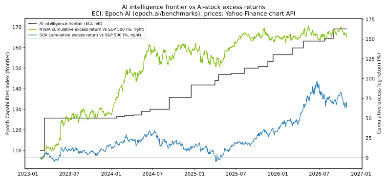

# AIの知能指数とAI株：仮説検証

**仮説**：「AIの知能指数が高まるにつれて、AI株は上がる」

**結論（bounded）**：本検証の設計（Epoch AI の ECI フロンティア、2023-03〜2026-10 の44か月）では、この仮説は**概ね支持されなかった**。知能フロンティアが跳んだ月に NVDA・SOX が S&P 500 を上回るという同時相関は統計的に確認できず、イベントスタディの証拠もまちまちだった。ただしバスケット（8銘柄等ウェイト）では統制回帰でのみ弱い正の係数が有意であり、全面的な否定でもない。「仮説が真／偽」とは主張しない。あくまで「この設計では支持されなかった」までである。

> 再現手順は末尾に記載。

---

## データと出典

### AI知能指数：Epoch AI「Epoch Capabilities Index (ECI)」
- 出典：Epoch AI, *Capabilities & benchmarking*（https://epoch.ai/benchmarks ）、データ一括ダウンロード（https://epoch.ai/benchmarks/use-this-data 経由、https://epoch.ai/data/benchmark_data.zip、CC BY 4.0、2026-11-01 取得）内の `epoch_capabilities_index/eci_scores.csv`。
- ECI は多数のベンチマーク結果から推定される複合能力指標で、時点間の比較可能性を意図して設計されている。本検証では「その日までにリリースされた全モデルの ECI 最大値」を**知能フロンティア**（階段状系列）とした。
- フロンティアの推移：110.07（2023-02-24、LLaMA-65B）→ 125.73（2023-03-14、GPT-4、**最大のジャンプ +15.66**）→ 141.82（2024-12-17、o1）→ 150.00（2025-08-07、GPT-5）→ 169.06（2026-09-03、GPT-6 Astra）。ステップは全21回。
- 頑健性用に同じ zip 内の `mmlu_external.csv`（報告ベースの MMLU スコア、出典リンク付き）からも MMLU フロンティアを構築した。

### Artificial Analysis Intelligence Index について（試行と不採用の記録）
- 当初は Artificial Analysis の Intelligence Index を第一候補とした。しかし公開モデルページに埋め込まれている指数値は直近の約30モデル分のみで、2023〜2026年のフロンティア構築には不足した（全履歴は API キーが必要）。そのため ECI に切り替えた。記録として残す。

### 株価：Yahoo Finance chart API（直接取得）
- 出典：query1.finance.yahoo.com/v8/finance/chart（User-Agent 付き、調整後終値）。yfinance はタイムアウトしやすく stooq はボットブロックされるため、前回の検証（TOPIX-17 混雑度）で成功した直接取得方式を用いた。
- 銘柄：NVDA、^SOX、^GSPC（S&P 500）、バスケット構成銘柄 AVGO・MU・MSFT・GOOGL・META・AMZN・TSM、統制変数として ^TNX（米10年金利×10）。期間 2021-01-04〜2026-10-30 の日次 1,464 営業日、欠損なし。
- 「AI株」のバスケットは上記8銘柄の等ウェイト（月次対数リターンの単純平均）。

## 方法

1. **月次相関**：知能フロンティアの月次対数変化 ΔI と、NVDA・SOX・バスケットの対 S&P 500 超過リターン（月次対数リターン差）の Pearson / Spearman 相関。同時・知能が1か月先行（ΔI_t と超過_{t+1}）・知能が1か月遅行（ΔI_t と超過_{t−1}）。
2. **イベントスタディ**：フロンティアの単日ジャンプが大きい上位10イベント（GPT-4、o1、o1-mini リリース日、GPT-5.2 Pro、GPT-5.5 Pro、GPT-5.4 Pro、o3、GPT-6 Astra、GPT-5、Gemini 3 Pro）をイベント日とし、NVDA・SOX の対 S&P 500 異常対数リターンを [−1,+5] と [0,+20] 営業日で累積（CAR）。平均・中央値・1標本 t 検定・符号検定。
3. **統制回帰**（月次 OLS）：超過リターン ~ 定数 + ΔI + 市場リターン + 米10年金利変化。
4. **サプライズ分解**：対数フロンティア水準の線形時間トレンドからの残差変化と超過リターンの相関。
5. **頑健性**：MMLU フロンティアでの同時相関。

## 結果

### 水準同士は「強く相関して見える」が、それは検定にならない
ECI 水準と累積超過リターンの相関は NVDA で r=0.81、SOX で r=0.80 ある（期間中の累積超過は NVDA +152%、SOX +64%）。しかし両系列とも右肩上がりのトレンドを持つため、この相関はほぼ機械的に生じる見かけのものである。仮説の検定は変化率で行う必要があり、以下がその結果である。

### 1. 月次相関（n=44、2023-03〜2026-10）：同時相関は確認できず
| 対象 | 同時 Pearson r (p) | Spearman ρ (p) | 知能先行 r (p) | 知能遅行 r (p) |
|---|---|---|---|---|
| NVDA | 0.11 (0.47) | 0.07 (0.67) | −0.14 (0.38) | −0.20 (0.19) |
| SOX | 0.10 (0.52) | 0.12 (0.43) | −0.15 (0.32) | −0.22 (0.15) |
| バスケット | 0.24 (0.12) | 0.24 (0.12) | 0.02 (0.88) | **−0.44 (0.003)** |

- 「知能が跳んだ月に株が上がる」「知能が跳んだ翌月に株が上がる」は、いずれの対象でも確認できなかった。
- 唯一有意なのはバスケットの**遅行相関が負**（ΔI_t と前月の超過リターン、r=−0.44、p=0.003、Spearman ρ=−0.38、p=0.013）である。解釈としては「大きな知能ジャンプは、AI株が冴えなかった月の後に起きやすい」という向きであり、仮説の支持にはならない。なお相関検定は計18通り行っており、多重比較の補正（Bonferroni 水準 ≈ 0.0028）に照らすとこの1件も決定的とは言えない。

### 2. イベントスタディ（10イベント）：証拠はまちまち
| 対象 | 窓 | 平均CAR | 中央値 | t検定 p | プラスの件数 | 符号検定 p |
|---|---|---|---|---|---|---|
| NVDA | [−1,+5] | +0.3% | −0.2% | 0.89 | 5/10 | 1.00 |
| NVDA | [0,+20] | +2.2% | +3.7% | 0.34 | 7/10 | 0.34 |
| SOX | [−1,+5] | +1.7% | +2.9% | 0.17 | 8/10 | 0.11 |
| SOX | [0,+20] | **+5.0%** | +2.8% | **0.029** | 8/10 | 0.11 |

- SOX の [0,+20] は平均 +5.0% で t 検定では5%有意だが、符号検定は有意でなく、n=10 と小さい。NVDA はどの窓でも有意でない。
- 最大イベント（GPT-4、2023-03-14）では NVDA の CAR は [−1,+5] +9.6%、[0,+20] +8.4% と大きいが、この時期は SVB 破綻直後の金融不安と NVIDIA 自身の GTC（2023-03-21）が重なっており、知能ジャンプ単独の効果とは識別できない。

### 3. 統制回帰：バスケットでのみ ΔI が有意
| 対象 | ΔI の係数 | 標準誤差 | p | R² |
|---|---|---|---|---|
| NVDA | 0.66 | 0.59 | 0.27 | 0.22 |
| SOX | 0.48 | 0.51 | 0.35 | 0.23 |
| バスケット | **0.73** | 0.28 | **0.012** | 0.45 |

- 市場リターンと金利変化で統制すると、バスケットでのみ知能変化の係数が正で有意になった（ΔI が +0.10 の月に超過リターンが約 +7.3% の関係）。単体の NVDA・SOX では有意でない。バスケットは分散により固有ノイズが消えるため検出力が上がった可能性と、多数の仕様の中の1件という多重性の問題の両方がある。

### 4. サプライズ分解：設計上の発見
階段状フロンティアでは、対数水準の線形トレンド残差の月次変化は ΔI_t −（トレンド傾き）という**定数シフトにちょうど等しく**、Pearson 相関は元の相関と数学的に同一になる。つまりこの頻度・この指標では「期待織り込み（サプライズ）」の分解は独立した検定にならない。結果は元の相関と同一（NVDA r=0.11、バスケット r=0.24、いずれも非有意）だった。サプライズを本当に測るには、リリース前の期待（例：予測市場や事前リーク）を別途観測する必要がある。

### 5. 頑健性（MMLU フロンティア、同時相関）
NVDA r=0.18 (p=0.23)、SOX r=0.07 (p=0.67)、バスケット r=0.18 (p=0.24)。結論は変わらない。

## 限界

- **サンプルが短い**：ECI の収録は 2023-02-24 開始のため月次 n=44 に過ぎない。特に **ChatGPT 公開（2022-11）という最大級の「知能→AI株」イベントは ECI の収録範囲外**であり、本検証はその後の期間だけを見ている。
- **階段状系列の検出力**：44か月のうちフロンティアが動かない月が多く、ΔI=0 の月が相関の情報を痩せさせる。
- **逆因果**：株価上昇 → AI設備投資・研究資金の増加 → 知能向上、という向きの因果を本設計では排除できない。
- **指標の恣意性と改訂**：ECI は Epoch AI がベンチマーク群から推定する潜在指標であり、方法論の改訂で過去値が再計算されうる。モデル日付も一部は評価・収録日ベースとみられ（例：GPT-4 Turbo (Nov 2023) の日付は 2024-01-25）、イベント日には数週間単位のノイズがありうる。
- **生存期間のみの観測**：対象は AI 相場が続いた 2023〜2026 年のみで、AI 株が長期低迷する局面を含まない。相場環境が違えば関係は変わりうる。
- **イベントの交絡**：モデルリリースは決算・製品イベント・金融政策と同日に重なりうる（GPT-4 の例を参照）。イベントスタディは統制群を持たない記述的な集計である。
- **多重比較**：相関・回帰・イベントを多数の組み合わせで検定しており、個別の有意性は割り引いて読む必要がある。
- MMLU は 2024 年末以降、主要モデルの公表が途絶え飽和も進んだため、頑健性チェックとしての射程は 2024 年までである。

## 再現手順

```bash
python3 fetch_prices.py        # data/prices.csv（Yahoo Finance chart API）
python3 build_intelligence.py  # data/eci_models.csv, data/mmlu_models.csv,
                               # data/intelligence_frontier.csv（Epoch AI zip を取得）
python3 analysis.py            # results.csv, summary.json,
                               # chart_intelligence_vs_stocks.svg, data/event_list.csv
```

依存：Python 3.12、pandas、numpy、scipy、matplotlib（statsmodels は不使用、OLS は自前実装）。

## ファイル

- `fetch_prices.py` / `build_intelligence.py` / `analysis.py`：取得・構築・分析コード
- `data/prices.csv`：日次調整後終値（2021-01-04〜2026-10-30）
- `data/eci_models.csv` / `data/mmlu_models.csv`：モデル別スコア（出典付き）
- `data/intelligence_frontier.csv`：日次フロンティア系列（ECI・MMLU、フロンティア保持モデル名付き）
- `data/event_list.csv`：イベントスタディ対象10イベントと銘柄別 CAR
- `results.csv` / `summary.json`：全検定結果
- `chart_intelligence_vs_stocks.svg`：知能フロンティアと NVDA・SOX 累積超過リターンの二軸グラフ



対象リポジトリ名：`ai-intelligence-vs-ai-stocks`（予定）
